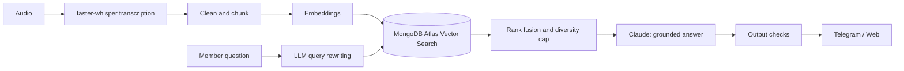

<h1 align="center">Hi, I'm Ayobami Ogunlade</h1>

<h3 align="center">
AI Engineer · LLM Applications, RAG &amp; Computer Vision
</h3>

<h3 align="center">
Full-Stack Mobile Developer
</h3>

<p align="center">
I build mobile applications and the full systems behind them from interface to backend to deployment with additional depth in AI/ML, security, and immersive technology.
</p>

<p align="center">
Lately my focus is AI engineering: grounded LLM assistants (RAG), speech-to-text pipelines and on-device vision models, shipped with the evaluation, safety checks and apps around them.
</p>

<p align="center">
<a href="https://www.linkedin.com/in/ayobami-ogunlade-7b776714b/">LinkedIn</a> •
<a href="https://www.behtafood.com">Behtafood</a> •
<a href="https://github.com/aynerd2">GitHub</a>
</p>

---

## About Me

I'm a Full-Stack Mobile Developer with a background in Computer Science and Artificial Intelligence.

I build complete mobile products end to end, from the interface a user touches, through the backend and APIs that power it, to the systems that keep it secure and running. Along the way, I've applied that same end-to-end approach to machine learning models, biometric authentication systems, immersive experiences, and startup products.

I'm currently the **Founder & CEO of Behtafood**, where I'm building a technology-driven food marketplace connecting customers, restaurants, and delivery partners.

I'm also building **Shepherd**, a retrieval-augmented generation (RAG) assistant that answers only from its source material, and **Olusho**, a multi-tenant platform that turns it into a product. See [Featured AI Project](#featured-ai-project) below.

I enjoy taking an idea beyond the prototype, from understanding the problem and designing the system to building, deploying, and continuously improving the product.

---

# What I Build

### Mobile & Full-Stack Product Engineering

* Mobile applications (native & cross-platform)
* Web platforms
* Backend APIs
* Payment systems
* Authentication systems
* Location-based applications
* Real-time systems
* Business platforms

### Artificial Intelligence & Machine Learning

I build and integrate practical AI systems into mobile and backend products, particularly around:

* LLM applications and retrieval-augmented generation (RAG)
* Retrieval quality: query rewriting, rank fusion, vector search
* Evaluation, guardrails and safety for LLM products
* Speech-to-text pipelines (Whisper)
* Computer Vision
* Image Classification
* Deep Learning
* Transfer Learning
* Biometric Security
* On-device Machine Learning
* Model Deployment
* AI-powered APIs

### Extended Reality

I also explore:

* Virtual Reality
* Extended Reality
* 3D applications
* Immersive learning
* Interactive storytelling

---

# Featured AI Project

## Shepherd: a grounded RAG assistant

An assistant that answers questions **only from a library of source documents** (here, a church's sermon recordings) and says so honestly when the library doesn't cover the question. It is live on Telegram and as a Next.js web widget.



**What I built and measured**

* **Retrieval:** 25,642 passages from 415 sermons in MongoDB Atlas Vector Search, with LLM query rewriting, rank fusion across search phrases and per-source diversity caps.
* **Grounding:** action plans where every step cites its source, plus a verification pass that drops unsupported steps.
* **Safety:** crisis-message routing, an honest "no answer" for off-topic questions, and checks that block invented figures and unsupported promises.
* **Quality:** 170+ automated tests and an acceptance suite that runs before each release.
* **Speech-to-text:** a GPU pipeline (faster-whisper, about 22x real time) that transcribed 1,400+ hours of audio, with resumable jobs and automatic quality and repetition-loop detection.
* **Efficiency:** cut vector storage 55% by moving embeddings to a compact binary format with identical exact-search results, and added a storage guard that stops a build before the database fills.

**Technologies:**

`Python` `FastAPI` `Anthropic Claude API` `MongoDB Atlas Vector Search` `ChromaDB` `faster-whisper` `Next.js` `Telegram Bot API`

> The source code is in a private repository. I'm happy to walk through the architecture.

<!-- When a public, sanitized version of the Shepherd repository exists, uncomment this line and put in its real URL:
🔗 [View Project](https://github.com/aynerd2/YOUR-REPO-NAME)
-->

---

# In Development

## Olusho: a multi-tenant AI platform

Turning Shepherd into a product: each organisation signs up, uploads its recordings and gets its own assistant, grounded only in its own content.

* Tenant isolation enforced in the database (PostgreSQL row-level security), proven by automated isolation tests
* Provider-agnostic interfaces for LLMs, embeddings, speech-to-text and payments, so no vendor can lock the product in
* An evaluation suite that gates any prompt, model or retrieval change in CI
* A written threat model, architecture decision records, and an agentic development workflow (Claude Code subagents, hooks and CI gates)

*Private repository.*

---

# Flagship Mobile Project

## SFMPAS — Secure Fingerprint Multi-factor Payment Authentication System

A full-stack mobile security system combining a native Android application with a secure backend for fingerprint-based payment authentication — pairing AI-based presentation attack detection with cryptography and mobile engineering.

The architecture combines:

* MobileNetV3-Small for fingerprint liveness detection
* Native Android application
* Android Keystore
* ECDSA cryptographic authentication
* On-device TensorFlow Lite inference
* Replay-resistant authentication
* FastAPI backend
* PostgreSQL
* Transaction-based authentication policies

The liveness model runs directly on the device and is designed so that **fingerprint images do not leave the device**.

**Technologies:**

`Python` `TensorFlow` `TensorFlow Lite` `MobileNetV3` `Kotlin` `Android` `FastAPI` `PostgreSQL` `Cryptography`

🔗 [View Project](https://github.com/aynerd2/Secure-fingerprint-base-Mobile-payment-authentication-system)

---

# Startup & Product Engineering

## Behtafood

I'm currently building **Behtafood**, a technology-driven food marketplace connecting customers, restaurants, and delivery partners — a full-stack, multi-app product spanning mobile, backend, and admin systems.

The ecosystem includes:

* Customer mobile application
* Rider & delivery application
* Restaurant/vendor platform
* Super Admin platform
* Digital wallet and payment infrastructure
* Location and map-based services
* Order and delivery management
* Weather-aware logistics
* Dynamic delivery pricing

**Technologies:**

`React Native` `Expo` `Next.js` `TypeScript` `Node.js` `Express.js` `MongoDB` `Paystack` `Cloudinary`

[Visit Behtafood](https://www.behtafood.com)

---

# AI & Machine Learning Projects

## Banana Leaf Disease Classifier

A deep-learning image classification system that identifies banana leaf diseases using **EfficientNetB0 transfer learning**.

The model classifies images into:

* Healthy
* Cordana
* Pestalotiopsis
* Sigatoka

The trained model achieved **97.91% test accuracy on a held-out dataset of 239 images**.

The project also includes a FastAPI integration example for serving predictions.

**Technologies:**

`Python` `TensorFlow` `Keras` `EfficientNetB0` `FastAPI` `Computer Vision`

🔗 [View Project](https://github.com/aynerd2/banana-leaf-disease-classifier)

---

## Nigerian Currency Classification API

An early computer-vision project exploring image classification for Nigerian currency notes.

The project demonstrates how a trained machine-learning model can be exposed through an API for real-world application integration.

**Technologies:**

`Python` `Keras` `TensorFlow` `Computer Vision` `REST API`

🔗 [View Project](https://github.com/aynerd2/keras_api)

**Later work:** my M.Sc. thesis extended this into a mobile app that detects counterfeit ₦1,000 and ₦500 notes with **95%+ real-time accuracy**, trained on 5,000+ images.

🔗 [App demo](https://bit.ly/45BmRJC) • [Dissertation](https://bit.ly/4gl8dei)

---

# XR & Immersive Technology

Beyond mobile and full-stack engineering, I have worked on immersive technology projects involving:

* Virtual Reality
* Extended Reality
* 3D environments
* Interactive storytelling
* Immersive education
* AI + 3D experiences

### Smile Superheroes

An immersive education initiative combining technology, storytelling, and XR to create engaging learning experiences for children.

**Focus:**

`XR` `Virtual Reality` `Immersive Learning` `Interactive Storytelling`

---

# Other Experiments

I enjoy building experimental projects to explore new technologies and ideas.

Some of my work includes:

* AI & 3D experiences
* Interactive 3D applications
* Web applications
* AI prototypes
* Mobile applications
* Full-stack applications

Check out my repositories for more experiments and technical explorations.

---

# 🛠️ Technology Stack

### Languages

`Python` `JavaScript` `TypeScript` `Kotlin`

### Frontend & Mobile

`React` `React Native` `Expo` `Next.js` `Tailwind CSS` `Android`

### Backend

`Node.js` `Express.js` `FastAPI` `REST APIs`

### Databases

`MongoDB` `PostgreSQL`

`MongoDB Atlas Vector Search` `ChromaDB`

### AI / Machine Learning

`TensorFlow` `Keras` `TensorFlow Lite` `Computer Vision` `Deep Learning` `Transfer Learning`

`Anthropic Claude API` `RAG` `Embeddings` `Vector Search` `Prompt Engineering` `LLM Evaluation` `faster-whisper`

### Cloud & Services

`MongoDB Atlas` `Vercel` `Cloudinary` `Paystack`

`Render`

### Developer Tooling

`Git` `CI/CD` `Claude Code`

### XR / 3D

`Three.js` `React Three Fiber` `Virtual Reality` `Extended Reality`

---

# Current Focus

I'm currently focused on building complete mobile products end to end, while continuing to apply AI/ML, security, and immersive technology to real-world problems:

```text
Mobile & Full-Stack Engineering
        ×
Artificial Intelligence
        ×
Real-world Products
        ×
Immersive Technology
```

I'm particularly interested in:

* Intelligent mobile applications
* Mobile security & authentication
* Applied AI
* AI-powered products
* Smart logistics
* XR and immersive experiences
* Startup & product development
* LLM applications and RAG systems
* AI evaluation, guardrails and safety
* Multilingual and speech-based AI
* Multi-tenant AI platforms and cost control
* Agentic software development

---

# Philosophy

I believe technology is most valuable when it moves beyond experimentation and becomes something people can actually use.

My approach is:

```text
Problem
   ↓
Research
   ↓
Idea
   ↓
System Design
   ↓
Build
   ↓
Test
   ↓
Deploy
   ↓
Learn
   ↓
Improve
```

I don't just want to write software.

**I want to build things that matter.**

---

# Let's Connect

I'm always interested in connecting with:

* Mobile & software engineers
* AI/ML researchers and builders
* AI engineers and LLM application builders
* Startup founders
* Product builders
* XR developers
* Technology innovators
* Potential collaborators

**LinkedIn:** https://www.linkedin.com/in/ayobami-ogunlade-7b776714b/

**Behtafood:** https://www.behtafood.com

**GitHub:** https://github.com/aynerd2

---

<p align="center">
<i>Building mobile products, end to end.</i>
<br>
<i>And now AI products too.</i>
</p>
